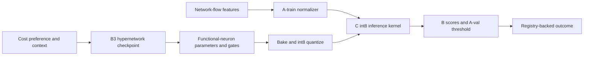

# Phase 5 demo

Start with the command in `README.md`, then open the localhost page. The dashboard
retains the offline research views and adds passive capture on the Traffic
Console. Select a local interface and start capture to see packet/bit rates,
bidirectional flow updates, int8 scores, model alerts, and local analysis-agent
events update as packets arrive. Stop capture from the same control.

Capture uses the installed `tcpdump` executable and the host's packet-capture
permissions. It writes no pcap file and does not alter or block traffic. The
flow adapter derives packet counts, IP bytes, duration, ports, transport
protocol, TCP flags/window, TTL, and packet-size statistics. NF-v2 application
fields such as identified L7 protocol, DNS response details, and retransmission
counters are unavailable from this header-only adapter and are set to zero.
IPv6 address handling and bidirectional direction are approximations. Live
scores are therefore a demonstration of inference on approximate flow features;
they have no ground-truth labels and are not validated IDS performance.

The six live roles are bounded local rule-based routines, not LLM agents. They
inspect observed feature drift, model score/threshold, architecture cost, and
triage priority. The Coordinator only sets a priority; no automated response is
executed. The Agent Notebook separately shows historical scripted research calls.
No LLM provider or credentials are bundled. For offline evaluation, the
Scoreboard, evasion, and benchmark replay continue to use the Phase 4 registry
and labeled recorded flows. Slider generation bakes the selected trained
checkpoint without retraining and records metrics, threshold provenance, and
artifact SHA-256 in `demo_actions.sqlite`.

The Posture view's **Domain shift → generated neural function** explorer
computes measured load/alert contexts for UNSW A-train and CSE B-evaluation,
then calls the trained hypernetwork and reports actual parameter, gate, MAC,
and int8 metric changes. It plots the generated network output while sweeping
one selected feature through real B percentiles, holding remaining features at
their B medians. Neuron gates and contribution deltas come from the generated
tensors. When both datasets map to the same context, the UI says that the
generated function is unchanged. User-selected context bins are explicitly
labeled as scenarios, not observed domain measurements.

## Model path

## Three-minute path

1. **0:00–0:25 — Business problem.** The first screen identifies the IT
   Infrastructure problem: detect attacks across network environments while
   measuring inference cost. Show the real B traffic count and A-val threshold.
2. **0:25–0:55 — Detection.** Traffic console replays labeled B flow scores from
   the C int8 candidate. Endpoint addresses are hidden. Show detection, FPR,
   PR-AUC and individual alert decisions. No production blocking is claimed.
3. **0:55–1:30 — Research mechanism.** Move the cost slider and change context.
   The server loads a real B3 checkpoint, generates and bakes new functional
   neuron parameters, quantizes them, checks C/Python bit equality and measures
   kernel latency. No optimizer step runs. Grey neurons are pruned. Run the
   context autopilot replay; it reports a cost change only if detection rates
   match within 2%. B has no verified temporal order, so this is a proxy.
   Kernel latency is measured on the same bounded 256-flow B timing batch;
   detection and bit-exact checks use the full B partition.
4. **1:30–1:55 — Evasion.** Run a constrained padding or jitter attack on B
   attack flows. Show the original and evasion detection rates; explain that
   this is a feature-space proxy with immutable endpoint/protocol fields.
5. **1:55–2:25 — Human oversight.** Agent notebook shows the recorded scripted
   proposal, decision and coarse B-validator outcome, including actual
   `reject/worse` candidate checks. These are separate from C1–C4 verdicts.
   Reject a local proposal
   to show execution blocked; approve another to record a clearly labeled
   controlled response simulation. No live LLM is implied.
6. **2:25–3:00 — Outcome and limits.** Scoreboard comes from the registry and
   shows B and once-only sealed results, seed bootstrap intervals and run
   budgets. Open Limits in one click. C1–C4 verdicts are inconclusive; local
   timings are unpinned and cannot establish a line-rate cycle budget.

The browser UI uses local HTML, CSS and JavaScript. The server binds to
`127.0.0.1` and does not fetch external assets or call a model API. Live capture
uses `tcpdump` only while capture is enabled. The recorded agent cycle is a
replay of actual tool decisions on sampled NF-v2 flows, with scripted proposals
and a coarse B-slice validator. The simulated response button writes a separate
local registry entry.

Run `make verify-phase5` for portable tests. The test suite exercises packet
decoding and feature mapping, model generation without an optimizer step,
constrained evasion, the approval gate, dashboard views, and in-process HTTP
routes. A local socket bind may be disallowed by some sandbox environments;
the in-process route tests do not require a socket. A successful live capture
still depends on the host granting `tcpdump` access to the selected interface.

The three-minute script is a presentation target. A timed manual dry run and a
clean-machine offline demo remain unverified in this checkout because the
Phase 4 study artifacts and raw datasets are absent.
