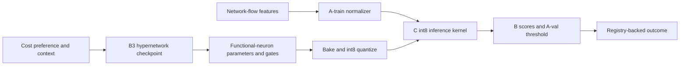

# Phase 5 offline demo

Start with the command in `README.md`, then open the localhost page. The five
views are Traffic console, Posture + autopilot, Evasion test, Agent notebook,
and Scoreboard. Every displayed score comes from the Phase 4 registry or from
an actual on-demand bake of its selected B3 hypernetwork checkpoint. Each
slider generation now writes its measured metrics, source run, threshold
provenance, and artifact SHA-256 to `demo_actions.sqlite`; the UI shows the
registry event ID. Generated artifacts have unique names so a later slider
movement cannot overwrite an earlier recorded artifact.

## Model path

## Three-minute path

1. **0:00–0:25 — Business problem.** The first screen identifies the IT
   Infrastructure problem: detect attacks across network environments while
   measuring inference cost. Show the real B traffic count and A-val threshold.
2. **0:25–0:55 — Detection.** Traffic console replays labeled B flow scores from
   the C int8 candidate. Endpoint addresses are hidden. Show detection, FPR,
   PR-AUC and individual alert decisions. No production blocking is claimed.
3. **0:55–1:30 — Research mechanism.** Move the cost slider and change context.
   The server loads a real B3 checkpoint, generates and bakes new functional
   neuron parameters, quantizes them, checks C/Python bit equality and measures
   kernel latency. No optimizer step runs. Grey neurons are pruned. Run the
   context autopilot replay; it reports a cost change only if detection rates
   match within 2%. B has no verified temporal order, so this is a proxy.
   Kernel latency is measured on the same bounded 256-flow B timing batch;
   detection and bit-exact checks use the full B partition.
4. **1:30–1:55 — Evasion.** Run a constrained padding or jitter attack on B
   attack flows. Show the original and evasion detection rates; explain that
   this is a feature-space proxy with immutable endpoint/protocol fields.
5. **1:55–2:25 — Human oversight.** Agent notebook shows the recorded scripted
   proposal, decision and coarse B-validator outcome, including actual
   `reject/worse` candidate checks. These are separate from C1–C4 verdicts.
   Reject a local proposal
   to show execution blocked; approve another to record a clearly labeled
   controlled response simulation. No live LLM is implied.
6. **2:25–3:00 — Outcome and limits.** Scoreboard comes from the registry and
   shows B and once-only sealed results, seed bootstrap intervals and run
   budgets. Open Limits in one click. C1–C4 verdicts are inconclusive; local
   timings are unpinned and cannot establish a line-rate cycle budget.

The browser UI uses only local HTML, CSS and JavaScript. The server binds to
`127.0.0.1`; it does not fetch external assets or call a model API. The
recorded agent cycle is a replay of actual tool decisions on the real sampled
flows, with scripted proposals and a coarse B-slice validator. The simulated
response button writes a separate local registry entry.

Run `make verify-phase5` for portable tests. The test suite exercises model
generation without an optimizer step, constrained evasion, the approval gate,
the five views, the limits control, and in-process HTTP routes. A local socket
bind may be disallowed by some sandbox environments; the in-process route tests
do not require a socket.

The three-minute script is a presentation target. A timed manual dry run and a
clean-machine offline demo remain unverified in this checkout because the
Phase 4 study artifacts and raw datasets are absent.
